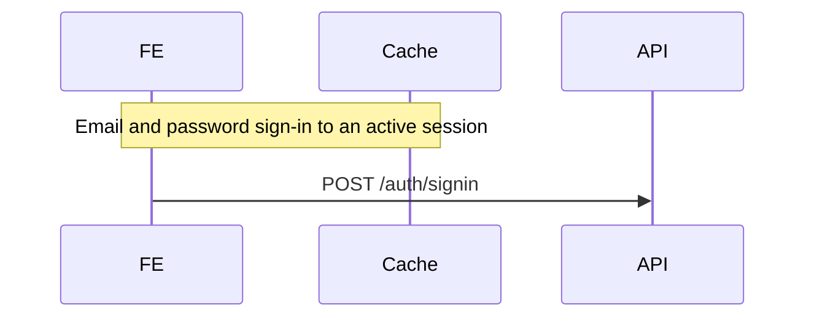

# Sequence Diagram

A business flow spans routes, services, libs and third parties. Nothing in the code
names it — the diagram file is the only place that boundary is recorded, so the file
is the source of truth and regeneration patches it rather than redrawing it.

## Regenerating (always try this first)

1. Read `docs/flows/<flow-id>.md`. Missing → fresh trace.
2. `git diff <generated_from>..HEAD -- <every path in sources>`
3. **Empty diff → report "unchanged", stop.** Do not open a single source file.
4. Non-empty → read only that diff plus the files it touches. Patch the affected
   rows. Keep participant order and every unaffected line byte-identical.
   Set `generated_from` to `git rev-parse --short HEAD`.

Never re-trace the repo when the file already exists. The committed diagram is the cache.

## Output contract

````md
---
flow: sign-in
title: Email and password sign-in to an active session
generated_from: a1b2c3d
participants: [FE, API, Auth, DB, Cache]
sources:
  - web/src/views/LoginForm.tsx
  - services/api/src/domain/session/sessionService.ts
---



| # | Step | Source |
| - | ---- | ------ |
| 1 | POST /auth/signin | `web/src/hooks/useAuth.tsx:264` |
````

`sources` lists file paths only — that is what `git diff` takes. The table carries the
line anchors.

## Fresh trace

Entry symbol → follow calls outward → stop at the terminal effect (cookie written,
response returned, job queued).

- Cross-service hop: pull the URL literal out of the call, then grep it in the target
  service's route definitions to find the handler. That resolves the hop without guessing.
- A call into `node_modules` ends the trace. The package becomes a participant box;
  do not read inside it.

## What is a step — flow mode (default)

Only boundary crossings: HTTP to another service, DB query, cache read or write,
cookie or storage write, third-party SDK call, queue publish.

Never: validation, logging, mapping, helpers, loops, error formatting, state setters.

Hard cap 15 steps. Over the cap means the flow is two flows — split it. Do not
compress labels to fit.

## Detail mode

`--detail <participant>` zooms one participant and shows its internal calls. Every
other participant collapses to a single in and out arrow. Never detail two at once —
that is what produces unreadable diagrams.

Detail output goes to `docs/flows/<flow-id>.<participant>.md` and carries its own
frontmatter.

## Rules

- Every step cites `file:line`. No citation means it was not verified — do not draw it.
- Participant order comes from frontmatter and never changes between runs.
- An inferred hop gets `%% unverified` on its line, so the next reader knows.

## Gotchas

- `sequenceDiagram` has no `title` directive; a bare `title:` line throws
  `UnknownDiagramError`. Use `Note over <first>,<last>` — it survives every renderer.
- One diagram per ```mermaid block. There is no multi-diagram syntax.
- Frontmatter `title:` renders on GitHub and `mmdc` but is dropped by the logged-in
  Mermaid Chart editor. `Note over` is drawn geometry and survives every export.
- If a shell hook wraps `grep` with a different binary, unusual flags such as `-h` or
  `--include` may be rejected. Call `/usr/bin/grep` by absolute path when that happens.
